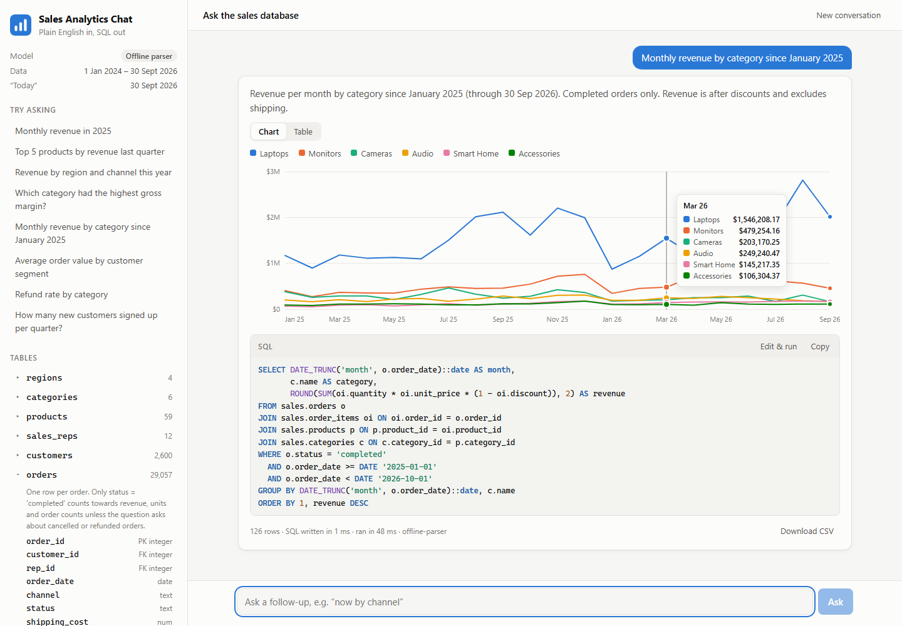
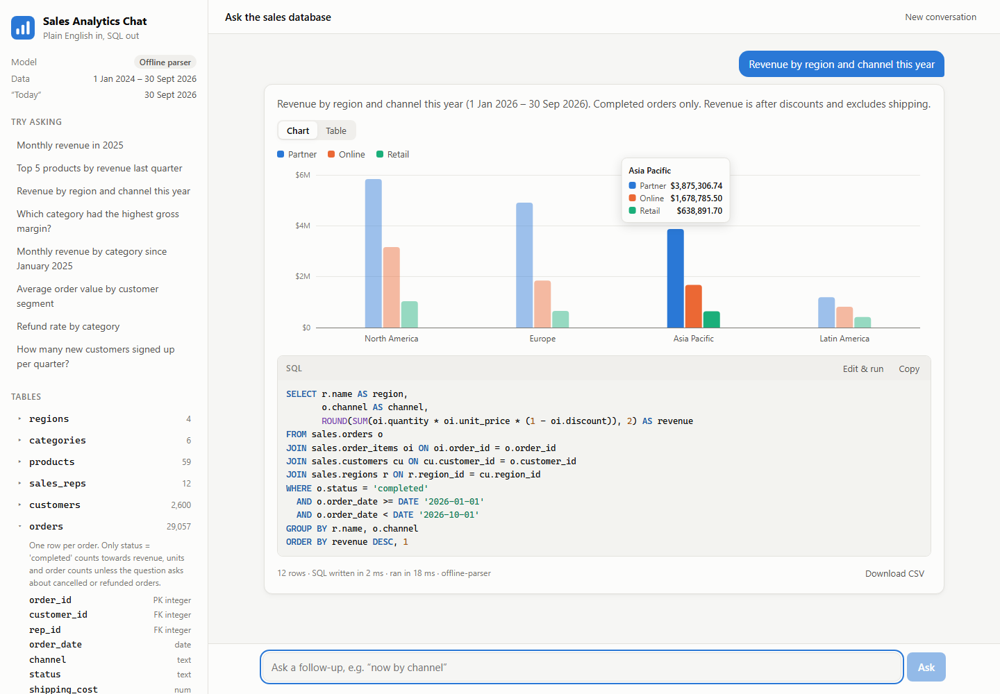
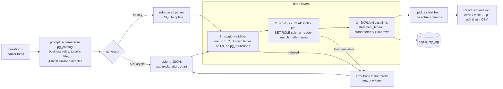

# Text-to-SQL Analytics Chat

Ask a PostgreSQL sales database questions in plain English and get back the generated SQL, a result table and a chart. FastAPI, PostgreSQL, sqlglot, the OpenAI API (or any compatible model), and React.

Business people ask questions like "which region grew fastest?" all day, and every one of them waits for an analyst to write a query. A chatbot that writes SQL can take that load, but only if you can **trust it not to change data, leak personal data or quietly return wrong numbers**. This app puts the schema, the business definitions ("revenue is after discount, completed orders only") and a few worked examples in front of the model. It then **checks every query in three layers before showing a result**. A sqlglot validator refuses writes, unknown tables, restricted columns and dangerous functions. The query runs in a **READ ONLY transaction as a role that can only SELECT the sales tables**. A **statement timeout and an EXPLAIN cost limit** stop runaway queries. When a query fails, the error goes back to the model so it can **fix its own SQL**. You see the SQL, the rows and a chart, and you can **edit the SQL and run it again**. Follow-ups like "now by region" refine the last answer. Without an API key a **rule-based parser** writes the SQL for the common question shapes, so everything works before you spend a token.



*From a real run in offline mode (the rule-based parser), because no OpenAI key was available when it was taken. With a key, the same UI shows SQL written by the model. Regenerate it with `scripts/make_screenshot.py`.*

| Grouped bars | Dark mode |
| --- | --- |
|  |  |

## How it works



**The data** ([sqlchat/seed.py](sqlchat/seed.py)). The demo database has 7 tables: `regions`, `categories`, `products`, `sales_reps`, `customers`, `orders` and `order_items`. That's 29,057 orders and 48,663 order lines from January 2024 to September 2026, generated from a fixed seed so every install has the same numbers. It has the patterns a real sales database has, so questions return something worth charting: growth, a November/December peak, a back-to-school bump for laptops, one category that grows and one that declines, enterprise customers who buy in bulk through sales reps, Black Friday discounts, a 2026 price rise, and cancelled or refunded orders that must be left out of revenue. Table and column comments carry the business definitions, and the model reads them.

**What the model sees** ([sqlchat/catalog.py](sqlchat/catalog.py), [sqlchat/llm.py](sqlchat/llm.py), [sqlchat/examples.py](sqlchat/examples.py)). The schema is read from `pg_catalog` at startup: tables, columns, types, keys, comments, and the distinct values of short text columns (so the model writes `status = 'completed'`, not `'Complete'`). Only columns the query role may SELECT are included, so the customers' `email` and `phone` never reach the prompt. The system prompt gives the business rules, today's date and the data range. It asks for one SELECT with readable column aliases, periods as dates and percentages from 0 to 100. The four worked examples whose questions share the most words with the new one are added, plus the last four questions and their SQL for follow-ups. The model replies with strict JSON (`sql`, `explanation`, `chart`). A question the data can't answer gets `sql: null` and a reason, not a guess.

**Layer 1: the validator** ([sqlchat/guard.py](sqlchat/guard.py)). sqlglot parses the SQL and refuses:

- more than one statement, or anything that isn't a query (INSERT, UPDATE, DELETE, DDL, COPY, SET, EXPLAIN)
- data-modifying CTEs (`WITH d AS (DELETE ...)`), `SELECT ... INTO`, `FOR UPDATE`
- tables outside the `sales` schema (`app.query_log`, `pg_catalog`, `information_schema`), and unknown tables
- restricted columns, `SELECT *` on a table that has them, and whole-row references like `row_to_json(c)`
- functions sqlglot doesn't recognize as standard, unless they're on an allowlist. That keeps out `pg_sleep`, `pg_read_file`, `set_config`, `dblink`, `lo_import` and `query_to_xml`.

The error messages are written to be sent back to the model ("Unknown table 'order_lines'. The tables are: ..."). The SQL that runs is the original text, not sqlglot's re-rendering of it, because that round trip isn't always faithful.

**Layers 2 and 3: the database** ([sqlchat/executor.py](sqlchat/executor.py)). The validator is a convenience, not the boundary. Every query runs as:

```sql
BEGIN;
SET TRANSACTION READ ONLY;            -- no writes, whatever the SQL says
SET LOCAL ROLE sqlchat_reader;        -- SELECT on sales.* only, no email/phone, nothing in app.*
SET LOCAL statement_timeout = 5000;
SET LOCAL search_path = sales;
EXPLAIN (FORMAT JSON) <query>;        -- refused above an estimated cost of 5,000,000
DECLARE c CURSOR FOR <query>; FETCH 1001 FROM c;   -- the app never holds more than 1001 rows
ROLLBACK;
```

`tests/test_executor.py` sends SQL straight to this layer, skipping the validator, and checks that writes, PII reads, reads of `app.*`, `; RESET ROLE` tricks, `pg_sleep` and cross joins all fail.

**Repair loop** ([sqlchat/service.py](sqlchat/service.py)). If the validator refuses a query or Postgres rejects it, the error goes back to the model in the same conversation ("That query failed: column "revenue" does not exist. Fix it."). That happens up to `MAX_REPAIRS` times. The UI shows "Fixed after 1 failed attempt" with the failed SQL and its error.

**Charts** ([sqlchat/charts.py](sqlchat/charts.py), [frontend/src/chart/](frontend/src/chart/)). The model suggests a chart before it has seen any rows. So the suggestion is checked against the real result, and when it doesn't fit, a chart is inferred from the column types:

- one value → a big number
- a period plus numbers → a line, with one line per category if there is one
- a category plus a number → bars, horizontal when there are many or long labels
- two categories plus a number → grouped bars

The charts are hand-drawn SVG. They use a fixed categorical palette that was checked for colour-blind separation in light and dark mode. They have hover tooltips and a legend whenever there's more than one series, and a table view is always one click away.

**The offline parser** ([sqlchat/offline.py](sqlchat/offline.py)). Without a model, a rule-based parser handles the question shapes a dashboard answers:

- measures (revenue, orders, units, AOV, customers, gross profit, margin, discounts, refund and cancellation rates, new customers) by dimensions (category, product, region, country, segment, channel, sales rep, customer) and time grains
- filters it finds in the question ("in Europe", "for laptops", "enterprise customers")
- periods: "Q3 2025", "last 90 days", "this year", "since March 2025", "2024 vs 2025"
- rankings ("top 5", "which month had the most"), shares, and follow-ups

It **declines** what it can't express, such as medians, "customers who bought both X and Y" or growth rates, instead of guessing. The evaluation below measures how often that's right.

## Tech stack

- **Backend:** Python 3.12, FastAPI, psycopg 3 + psycopg-pool, pydantic-settings
- **Database:** PostgreSQL 17 (Docker) or 16 via the `pgserver` wheel (`DATABASE_URL=embedded`, no Docker needed)
- **SQL validation:** sqlglot (PostgreSQL dialect)
- **Models:** OpenAI SDK with strict structured outputs. Any OpenAI-compatible server (Ollama, vLLM, LM Studio) works with `LLM_JSON_MODE=json_object`.
- **Frontend:** React 19, TypeScript 6, Vite 8, hand-drawn SVG charts, no UI or chart library
- **Tests:** pytest against real Postgres, Vitest, an execution-accuracy evaluation harness
- **Ops:** Docker multi-stage build, docker compose, GitHub Actions

## Run it

### Docker

```bash
cp .env.example .env        # optional: add OPENAI_API_KEY
docker compose up --build
```

Open http://localhost:8000. The first start creates the `sales` schema, generates the data (a few seconds) and creates the read-only role.

### Without Docker

```bash
python -m venv .venv && .venv/Scripts/activate      # or source .venv/bin/activate
pip install -r requirements-dev.txt
echo DATABASE_URL=embedded > .env                    # private Postgres in data/pgdata
python -m sqlchat serve                              # http://127.0.0.1:8000

cd frontend && npm install && npm run build          # the UI the server serves
npm run dev                                          # or: hot reload on :5173, proxying /api
```

`DATABASE_URL` can also point at any Postgres you have. The login user needs CREATEROLE once, for the seed to create `sqlchat_reader`. In production, use a separate login that owns nothing.

### Use a real model

```bash
# OpenAI
OPENAI_API_KEY=sk-...
CHAT_MODEL=gpt-4.1-mini

# or a local model through Ollama
OPENAI_BASE_URL=http://localhost:11434/v1
CHAT_MODEL=qwen2.5-coder:7b
LLM_JSON_MODE=json_object
```

## API

| Method | Path | |
| --- | --- | --- |
| `POST` | `/api/ask` | `{"question": "...", "history": [{"question": "...", "sql": "..."}]}` → SQL, explanation, columns, rows, chart, failed attempts, timings |
| `POST` | `/api/sql` | `{"sql": "..."}`: run hand-written SQL through the same checks |
| `GET` | `/api/schema` | tables, columns, comments, row counts, restricted columns, and the schema text the model sees |
| `GET` | `/api/meta` | generator, data range, reference date, example questions |
| `GET` | `/api/history` | the query log: question, SQL, status, error, rows, attempts, duration |
| `GET` | `/api/health` | database check |

## CLI

```bash
python -m sqlchat ask "Monthly revenue in 2025" "now by category"   # several = one conversation
python -m sqlchat sql "SELECT channel, count(*) FROM orders GROUP BY 1"
python -m sqlchat schema            # the schema exactly as the model sees it
python -m sqlchat seed --reset      # regenerate the data (--seed, --scale)
```

## Tests and evaluation

```bash
pytest -q -p no:cacheprovider       # 186 tests against real Postgres (pgserver, or TEST_DATABASE_URL)
cd frontend && npm test             # 10 tests: chart data, formatting, SQL highlighting
python scripts/evaluate.py          # execution accuracy, see below
```

The backend tests use real Postgres for everything that touches SQL. They cover:

- the validator: 30 refused patterns and the false positives it must not raise
- the database boundary with the validator bypassed
- the seeded data's patterns
- catalog introspection
- the offline parser: periods, measures, filters, rankings, follow-ups, refusals
- the LLM generator against a fake OpenAI endpoint (`httpx.MockTransport`): prompt contents, strict JSON mode, the repair loop with real Postgres errors, giving up after `MAX_REPAIRS`, outages
- chart inference, the API, and the evaluation harness itself

Every few-shot example and every gold query is also run against the database, so they can't drift from the schema.

### Measured accuracy

[scripts/evaluate.py](scripts/evaluate.py) asks each question through the full pipeline (validator, read-only role, repair loop) and compares the rows with a gold query's rows. Comparing SQL text would be useless, since there are many right ways to write a query. Column names, column order, row order and rounding below 0.1 are ignored, but the set of rows must match, so a "top 5" has to be the right five. Follow-ups are asked after their history in the same conversation. Questions with no gold SQL must be refused.

| Offline parser, measured 2026-10-30 | Dev set (41 + 5 refusals) | Held-out set (20 + 3 refusals) |
| --- | --- | --- |
| Execution accuracy | **34 / 41 (83%)** | **13 / 20 (65%)** |
| Right when it answers | 34 / 34 (100%) | 13 / 17 (76%) |
| Declined | 7 | 3 |
| Wrong answer | 0 | 4 |
| Correctly refused (writes, PII, off-topic) | 5 / 5 | 3 / 3 |

**Read these numbers with care.** The parser's rules were written while looking at the dev set ([evals/questions.jsonl](evals/questions.jsonl)), so 83% with no wrong answers is an upper bound. The held-out set ([evals/holdout.jsonl](evals/holdout.jsonl)) was written afterwards and never tuned on. Its four wrong answers show where the parser breaks:

- "Which 5 countries have the most customers?" ranked customers by revenue.
- "Just for online orders", asked as a follow-up to an AOV question, lost the AOV measure.
- "The single largest order" counted orders.
- "Black Friday week (Nov 24-30)" ignored the day range and used the whole year.

Both sets include "hard" questions (medians, set logic, growth rates, per-customer conditions) that the parser is built to decline. Every one of them is declined, and none gets a guessed answer.

**The LLM path has not been measured yet.** No OpenAI key or working local model was available when this was built. To measure it, run:

```bash
python scripts/evaluate.py --generator openai --model gpt-4.1-mini --json results.json
```

## Configuration

All settings are environment variables (or `.env`). See [.env.example](.env.example).

| Variable | Default | |
| --- | --- | --- |
| `DATABASE_URL` | local Postgres | or `embedded` |
| `QUERY_ROLE` | `sqlchat_reader` | the role generated SQL runs as |
| `STATEMENT_TIMEOUT_MS` | `5000` | |
| `MAX_ROWS` | `1000` | rows returned; the UI says when there were more |
| `MAX_QUERY_COST` | `5000000` | EXPLAIN cost above which a query is refused (the gold queries here cost at most ~6,800; a cross join of order_items with itself is ~35 million) |
| `OPENAI_API_KEY` / `OPENAI_BASE_URL` | | either one switches from the offline parser to the LLM |
| `CHAT_MODEL` | `gpt-4.1-mini` | |
| `LLM_JSON_MODE` | `json_schema` | `json_object` for Ollama and most compatible servers |
| `MAX_REPAIRS` | `2` | |
| `FEW_SHOT_EXAMPLES` / `HISTORY_TURNS` | `4` / `4` | |
| `REFERENCE_DATE` | latest order date | what "last month" is relative to |

## Limitations

- **The LLM path is tested, not measured.** The prompt, structured output, repair loop and error handling are covered by tests against a fake endpoint. Real accuracy with OpenAI or a local model hasn't been run (see above).
- **The validator is not a SQL firewall.** It is there to give the model useful errors. The read-only transaction, role, timeout and cost limit are what keep the database safe. Point `DATABASE_URL` at a replica in production anyway.
- **Restricted columns are matched by name.** A CTE output column called `email` is refused too. That's a false positive, but on the safe side.
- **The cost limit is an estimate.** It catches cross joins and huge scans. The statement timeout catches the rest.
- **No authentication or rate limiting.** Anyone who can reach the API can run read-only queries and spend model tokens. Put it behind your SSO, or add a key check, before exposing it.
- **One database, one schema.** Schema linking (picking relevant tables for a large warehouse) isn't needed for 7 tables and isn't implemented. With hundreds of tables, the prompt would need retrieval over the catalog.
- **The offline parser covers common shapes only.** See the evaluation above. Day ranges ("Nov 24-30"), per-entity conditions ("more than 5 orders") and growth rates need the LLM.
- **Docker and CI are untested here.** No Docker was available when this was built. The app, tests and screenshots ran against PostgreSQL 16 from the `pgserver` wheel. The compose file uses PostgreSQL 17.

## Project layout

```
sqlchat/
  config.py       settings (.env)
  seed.py         schema, comments, read-only role, deterministic data generator
  db.py           connection pool, app.query_log, embedded Postgres
  catalog.py      schema introspection → prompt text, restricted columns, dimension values
  guard.py        sqlglot validator (layer 1)
  executor.py     read-only execution: role, timeout, cost limit, cursor (layers 2-3)
  examples.py     few-shot examples + similarity selection
  llm.py          prompt, strict JSON output, OpenAI-compatible generator, repair
  offline.py      rule-based parser: periods, measures, dimensions, follow-ups → SQL
  charts.py       chart choice from the real result
  service.py      pipeline, repair loop, query log
  evaluation.py   execution-accuracy comparison
  api.py          FastAPI routes + static UI
frontend/src/     React app: chat thread, SVG charts, table, SQL editor, schema browser
evals/            dev and held-out question sets with gold SQL
scripts/          evaluate.py, make_screenshot.py
tests/            pytest suite (real Postgres) + fake OpenAI endpoint
```

## sort entries

Updated implementation details.

## format output

Updated implementation details.

## sort entries

Updated implementation details.

## format output

Updated implementation details.